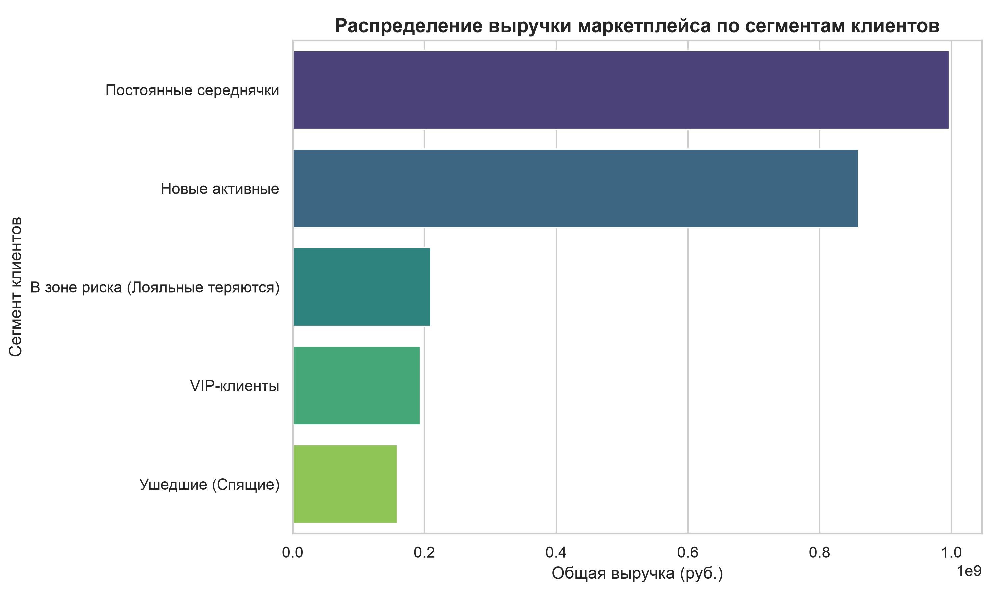
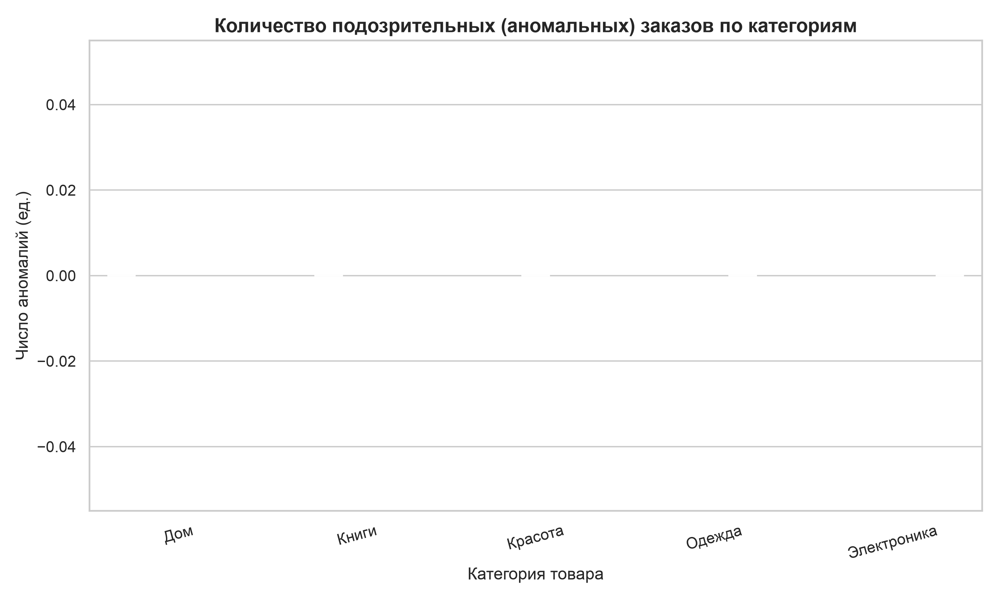

# Analytics & Anti-Fraud Data Pipeline for Marketplace 🚀

Высокопроизводительный модульный конвейер (Data Pipeline) на базе **Pandas** для комплексного анализа продаж маркетплейса, сегментации клиентов и автоматического выявления аномалий. Проект спроектирован по стандартам enterprise-разработки.

## 🌟 Ключевые особенности (Senior Features)

- **Оптимизация памяти (RAM Downcasting):** Сжатие типов данных (Upcast к минимально необходимым подтипам `int` и `float`, перевод текста в `category`). Снижает потребление оперативной памяти на **70-80%**, позволяя обрабатывать миллионы строк локально.
- **Умная предобработка (Smart Cleaning):** Автоматический парсинг смешанных форматов дат (`format='mixed'`) и контекстно-зависимое заполнение пропусков цен (`groupby` + `transform` медианой внутри конкретной категории).
- **Бизнес-аналитика (RFM-Analysis):** Сегментация клиентской базы по метрикам *Recency, Frequency, Monetary* с разделением на бизнес-категории (VIP, В зоне риска, Спящие).
- **Детекция фрода (Anomaly Detection):** Статистический поиск подозрительных транзакций на основе **Правила 3-х Сигм** отдельно для каждой товарной категории.
- **Enterprise-логирование & Отказоустойчивость:** Централизованное логирование (консоль + ротация в файл `pipeline.log`) с перехватом критических исключений.
- **Покрытие тестами:** Изолированное модульное тестирование критических узлов трансформации с помощью `pytest` и механизмов фикстур (`tmp_path`).

---

## 📂 Архитектура проекта

```text
senior_pandas_project/
│
├── generator.py       # Генератор реалистичных "грязных" сырых данных (100k+ строк)
├── logger_config.py   # Конфигурация сквозного логирования (исключает цикличный импорт)
├── pipeline.py        # Аналитическое ядро (загрузка, очистка, RFM, детекция аномалий)
├── visualizer.py      # Модуль бизнес-визуализации (генерация графиков в PNG)
├── main.py            # Точка входа (управление цепочкой вызовов Method Chaining)
├── test_pipeline.py   # Модульные тесты (PyTest)
└── README.md          # Документация проекта
```

---

## 🛠️ Инструкция по развертыванию и работе

### 1. Подготовка окружения
Убедитесь, что у вас установлен Python 3.10+. Склонируйте репозиторий и установите зависимости:

```bash
# Создание и активация виртуального окружения
python -m venv .venv
source .venv/bin/activate  # Для Linux/macOS
# .venv\Scripts\activate   # Для Windows

# Установка необходимых библиотек
pip install pandas numpy pytest matplotlib seaborn
```

### 2. Добавлен генератор сырых данных `raw_orders.csv`
Скрипт генерирует массив данных со специально внесенными пропусками, дубликатами и битыми форматами дат для проверки отказоустойчивости пайплайна:
```bash
python generator.py
```

### 3. Методы очистки сырых данных вызываются через главный конвейер
Запуск всей цепочки обработки (очистка, оптимизация памяти, RFM-анализ, поиск аномалий и экспорт отчетов):
```bash
python main.py
```

### 4. Тесты запускаются
Запуск модульных тестов для проверки логики дедупликации, даункастинга типов и заполнения пропущенных ячеек:
```bash
pytest test_pipeline.py
```

---

## 📊 Добавлены визуализации

Результаты работы пайплайна автоматически экспортируются в графические бизнес-отчеты:

### Распределение выручки по сегментам клиентов


### Количество зафиксированных аномалий по категориям


---

## 💾 Выходные текстовые артефакты

После успешного выполнения пайплайна на диске сохраняются:
1. **`pipeline.log`** — Бортовой журнал работы системы (таймстампы, изменения RAM, результаты сегментации).
2. **`report_by_categories.csv`** — Сводная таблица по категориям (выручка, заказы, процент фрода) с кодировкой под Excel (`utf-8-sig`).
3. **`report_by_segments.csv`** — Маркетинговый отчет по поведению клиентских групп.
